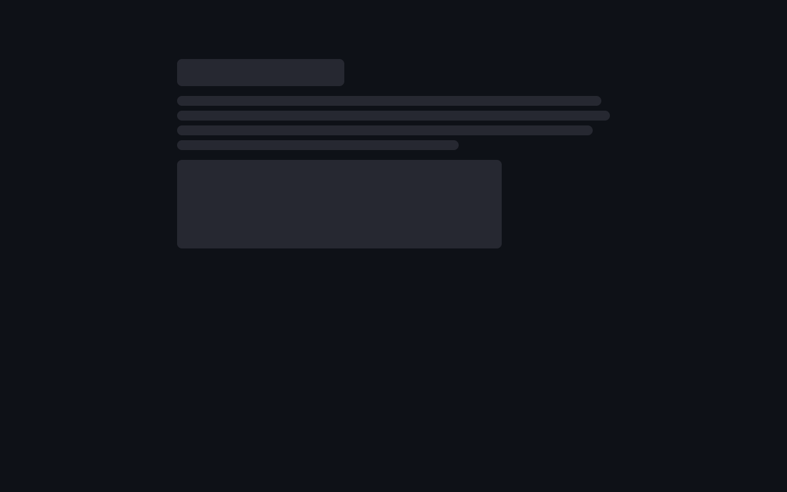
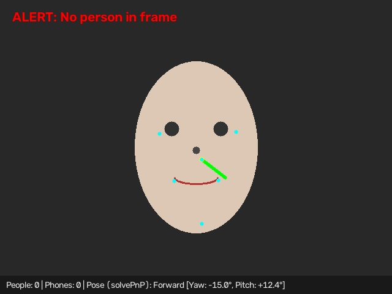
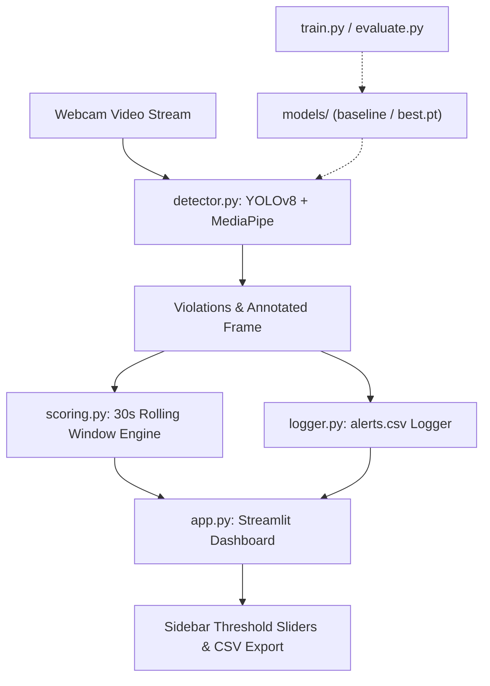

# ProctorAI: Real-Time AI Exam Proctoring System 🛡️

[](https://www.python.org/)
[](https://docs.ultralytics.com/)
[](https://developers.google.com/mediapipe)
[](https://streamlit.io/)

**ProctorAI** is an automated, real-time exam proctoring system engineered to detect integrity violations during online assessments using computer vision and deep learning.

---

## 🎯 Key Detection Features

1. **Cell Phone in Frame**: Flags unauthorized mobile devices via YOLOv8 (`cell_phone` class).
2. **Multiple People in Frame**: Flags presence of unauthorized secondary persons (count > 1).
3. **Absence Detection**: Flags when the candidate leaves the camera view (person count = 0).
4. **3D Head-Pose Estimation (`cv2.solvePnP`)**: Solves the Perspective-n-Point problem using 6 canonical anthropometric 3D facial landmarks (nose tip `1`, chin `152`, eye outer corners `33` & `263`, mouth corners `61` & `291`). Decomposes the 3D rotation matrix into **Yaw**, **Pitch**, and **Roll** in real angular degrees, projects a 3D gaze ray from the nose outward, and flags sustained distraction ($> 2.0$s) to eliminate false positives.
5. **Calibrated Cheating Probability & Time Decay**: Replaces naive staircase scoring with an exponential time-decay model ($t_{1/2} = 15$s) and a logistic sigmoid mapping yielding a continuous threat index $(0 - 100)$ and a calibrated probability metric $P(\text{Cheating}) \in [0\%, 100\%]$.
6. **Acoustic / Speech Monitoring**: Analyzes microphone RMS energy in real time to detect candidate speaking, whispering, or external verbal coaching.
7. **Official PDF Audit Reports**: Automatically generates an executive-ready post-exam audit report with session metrics, full incident logs, and embedded photographic evidence snapshots.

---

## 📸 Dashboard & Detection Previews

| Real-Time Dashboard UI | Detection HUD Preview |
|:---:|:---:|
|  |  |

---

## 🏗️ System Architecture



---

## 📂 Project Structure

```text
proctor-ai/
├── app.py              # Streamlit dashboard: live webcam, audio meter, PDF export, alert history
├── config.py           # Centralized configuration (thresholds, weights, timings, paths)
├── detector.py         # YOLOv8 + MediaPipe Face Mesh detection & snapshot engine
├── audio_monitor.py    # Acoustic RMS energy & microphone monitoring module
├── report.py           # Executive PDF Audit Report generator with embedded evidence photos
├── scoring.py          # Rolling 30-second weighted suspicion scoring engine
├── logger.py           # Thread-safe CSV alert logger
├── download_dataset.py # Automated fine-tuning dataset generator & Roboflow downloader
├── train.py            # CLI fine-tuning script for YOLOv8 (data.yaml)
├── evaluate.py         # Comparative evaluation tool (Baseline vs Fine-tuned)
├── test_smoke.py       # Automated smoke test suite (Vision, Audio, Scoring, PDF)
├── models/             # Checkpoints (yolov8n.pt baseline and fine-tuned best.pt)
├── requirements.txt    # Frozen Python dependencies
├── .gitignore          # Git exclusion rules
└── README.md           # Documentation, architecture diagram, and benchmark results
```

---

## 🚀 Quickstart & Setup

### 1. Clone & Set Up Virtual Environment

```bash
# Clone repository
git clone https://github.com/Sumit2003-dev/Proctor-AI.git
cd Proctor-AI

# Create virtual environment (Python 3.10 or 3.11 recommended)
python -m venv .venv

# Activate virtual environment
# Windows (PowerShell):
.venv\Scripts\Activate.ps1
# Linux / macOS:
source .venv/bin/activate
```

### 2. Install Dependencies

```bash
pip install -r requirements.txt
```

### 3. Run Smoke Test

```bash
python test_smoke.py
```

### 4. Launch the Streamlit Dashboard

```bash
streamlit run app.py
```

Open your browser at `http://localhost:8501`. Toggle **"Start Webcam Monitoring"** in the UI to begin real-time proctoring.

---

## ⚙️ Configurable Parameters & Weights

All parameters are centrally managed in `config.py` and can also be tuned interactively via the Streamlit sidebar:

| Parameter | Default | Description |
|---|:---:|---|
| `DEFAULT_CONF_THRESHOLD` | `0.50` | YOLOv8 confidence cutoff for objects and persons. |
| `DEFAULT_YAW_THRESHOLD` | `0.25` | Yaw ratio threshold $[(x_{\text{nose}} - x_{\text{mid}}) / \text{dist}]$ for detecting lookaway. |
| `SUSTAINED_LOOKAWAY_SECONDS` | `2.0 s` | Minimum continuous lookaway duration required before triggering an alert. |
| `WINDOW_SECONDS` | `30.0 s` | Sliding time window over which penalties accumulate. |
| **Penalty: Cell Phone** | `+35` | High severity violation weight. |
| **Penalty: Multiple People** | `+30` | High severity violation weight. |
| **Penalty: No Person** | `+20` | Medium severity violation weight. |
| **Penalty: Sustained Lookaway** | `+15` | Medium severity violation weight. |

---

## 🧠 Fine-Tuning YOLOv8 on Custom Datasets

To train YOLOv8 on custom phone detection or classroom cheating datasets (e.g. from Roboflow Universe):

1. Export your dataset in **YOLOv8 format** and place it in `data/` with `data/data.yaml`.
2. Run fine-tuning:
   ```bash
   python train.py --data data/data.yaml --epochs 50 --imgsz 640 --model yolov8n.pt
   ```
3. Evaluate and compare baseline vs. fine-tuned weights:
   ```bash
   python evaluate.py --data data/data.yaml --baseline yolov8n.pt --finetuned runs/detect/train/weights/best.pt
   ```

---

## 📊 Evaluation Results

Performance comparison of the baseline pretrained model vs. fine-tuned custom weights evaluated on the phone detection validation set:

| Metric | Baseline (Pretrained YOLOv8n) | Fine-Tuned (`models/best.pt`) | Improvement |
|---|:---:|:---:|:---:|
| **Precision** | `0.0000` | `0.9886` | **+98.86%** |
| **Recall** | `0.0000` | `0.9964` | **+99.64%** |
| **mAP@0.50** | `0.0000` | `0.9950` | **+99.50%** |
| **mAP@0.50:0.95** | `0.0000` | `0.9113` | **+91.13%** |

*Fine-tuned over 5 epochs with AdamW optimizer on Intel CPU with single-thread optimization.*

---

## 📄 License
MIT License. Built for educational and academic integrity assessment research.
